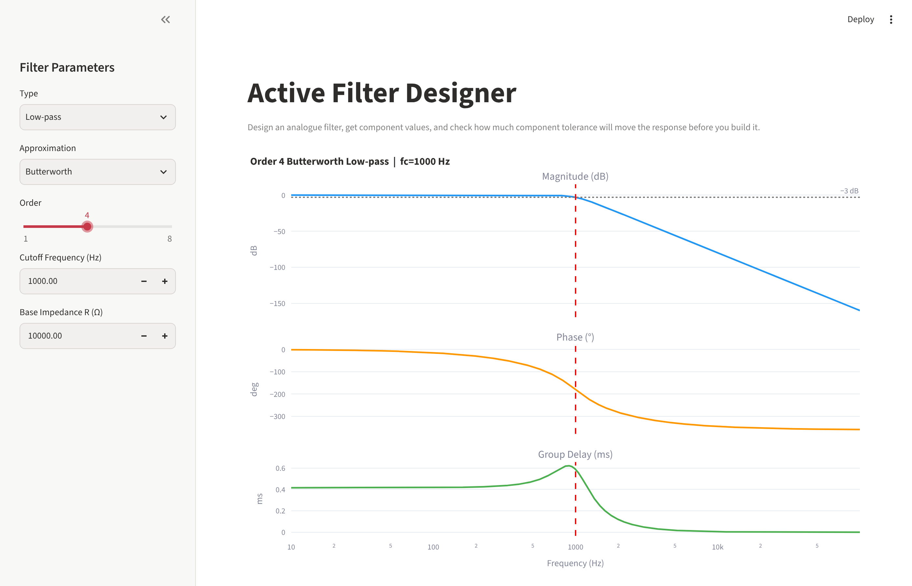
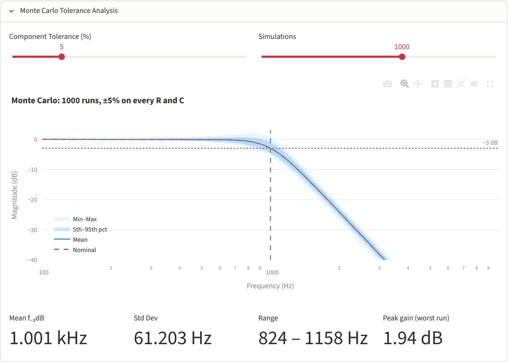

# Active Filter Designer

A small Streamlit app I wrote to design analogue active filters and check how
component tolerance affects them **before** the board gets made.



## Why I made this

In our second-year design project, a lot of the problems we hit on real
hardware came from component tolerance, not from the circuit idea itself.
The simulation looked fine with ideal parts, then the PCB came back with
cutoff frequencies and thresholds in the wrong place because of ±5 % resistors
and capacitors.

I wanted something quick that gives me the component values for a filter and
then tells me how much the response will move with real parts, so I could pick
tighter tolerances (or add trimming) at the design stage instead of finding out
on the bench.

## What it does

- Low-pass, high-pass, band-pass and band-stop filters
- Butterworth, Chebyshev I/II, Elliptic and Bessel responses, order 1–8
- Bode plot (magnitude, phase, group delay), step/impulse response and pole-zero map
- **Sallen-Key** component values for low-pass / high-pass (equal-component design,
  gain K sets Q), split into 2nd-order sections
- **Tow-Thomas** biquad values for band-pass
- Bill of materials, downloadable as CSV
- **Monte Carlo tolerance analysis** (see below)

## Monte Carlo tolerance analysis



Every resistor and capacitor in each stage (R1, R2, C1, C2 and the gain resistors
Rf, Rg) gets its own random error within ±tolerance. For each run, ω₀ and Q are
recalculated from the actual part values using the Sallen-Key equations:

```
ω₀ = 1 / sqrt(R1·R2·C1·C2)

low-pass:   1/Q = [ C2(R1 + R2) + R1·C1(1 − K) ] / sqrt(R1·R2·C1·C2)
high-pass:  1/Q = [ R1(C1 + C2) + R2·C2(1 − K) ] / sqrt(R1·R2·C1·C2)

K = 1 + Rf/Rg
```

The app then plots the spread of responses and reports the mean, standard
deviation and range of the −3 dB frequency, plus the worst-case peaking.

One thing this showed me: for high-order Chebyshev filters the equal-component
design needs K very close to 3, so a few percent error in Rf/Rg can push Q
negative and the stage becomes unstable. The app counts and reports those runs.
In practice that means using a different design method (e.g. unity-gain
Sallen-Key with unequal capacitors) for high-Q stages.

## Running it

```bash
pip install -r requirements.txt
streamlit run app.py
```

Tested with Python 3.13 and Streamlit 1.67.

## Limitations / to do

- Elliptic and Chebyshev II filters have transmission zeros, so the app shows
  the response but doesn't give a circuit for them yet
- Band-stop only shows section parameters, no topology yet
- Op-amps are treated as ideal (no GBW or slew-rate limits)
- Monte Carlo uses a uniform distribution within the tolerance band
